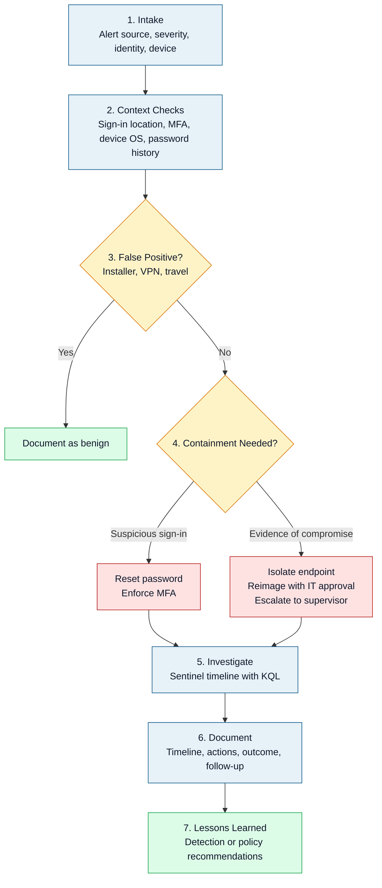

# Danielle Respes

Applying endpoint and identity investigation with Microsoft Defender, Microsoft Sentinel, Entra ID, and KQL to triage alerts, separate real threats from false positives, and respond to compromised accounts.

> [!NOTE]
> Learning KQL and Defender is not required by my current role. I do this work on my own to build deeper cybersecurity skills beyond help desk responsibilities.

## Triage Process

Account disables and reimaging require supervisor or IT leadership approval. A disabled account stays locked until staff reactivate it.

## Core Tools

Microsoft Sentinel · KQL · Defender for Endpoint · Defender XDR · Entra ID · Microsoft 365 · Intune · MITRE ATT&CK · NIST 800-61

## Skills

- Alert triage and false-positive analysis
- KQL queries across Defender and Entra sign-in and endpoint data
- Identity response: password reset, MFA enforcement, sign-in risk review
- Endpoint containment and reimaging with IT leadership
- Clear documentation for supervisors and account owners
- Collaboration with IT leadership and senior staff on containment, reimaging, and user communication decisions

## Lab Work

| Project | Summary |
|---|---|
| [Northpeak Descent Cross-Platform Intrusion Investigation](https://github.com/Danielle-Respes/Northpeak-Descent-Cross-Platform-Intrusion-Sentinel-KQL-2026) | Lab investigation across Windows and Linux telemetry in Defender for Endpoint and Sentinel, using KQL to reconstruct the intrusion sequence and separate real logon activity from noise. |
| [Copilot Prompt-Injection Threat Hunt (EchoLeak)](https://github.com/Danielle-Respes/Threat-Hunt-EchoLeak-Copilot-Prompt-Injection-Sentinel-KQL-Oct-2026) | Simulated M365 Copilot data. Traced an attack path and exfiltration channel in Sentinel, and documented log gaps. |
| [Vulnerability Management Program](https://github.com/Danielle-Respes/Vulnerability-Management) | Tenable scanning in Azure VMs, CVSS prioritization, and a mock Change Advisory Board review. |

## Contact

github.com/Danielle-Respes
