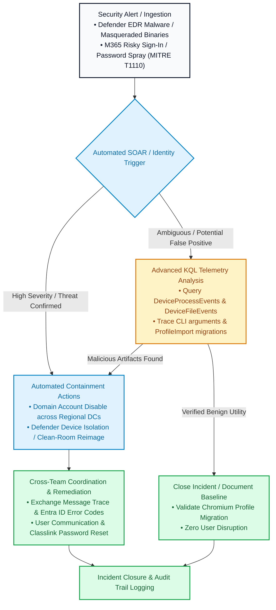

# Help Desk Security & Incident Triage Playbook

> A portfolio of sanitized incident response workflows, KQL hunting queries, and operational playbooks developed from real-world educational IT environments.

[](https://github.com)
[](https://github.com)
[](https://github.com)

## Professional Focus

I remain deeply curious and engaged in my current Help Desk role. I continuously expand my original scope of work by taking ownership of security triage, Advanced Hunting with KQL, SOAR playbook correlation, and cross-team containment efforts. These experiences are deliberately building the practical foundation for my next position in cybersecurity.


## Portfolio Overview

| Aspect         | Details                                                                                                                  |
|----------------|--------------------------------------------------------------------------------------------------------------------------|
| **Domain**     | IT Help Desk Operations & Cybersecurity Incident Response                                                                |
| **Core Tools** | Microsoft Defender for Endpoint, Adlumin, Entra ID, Windows SOAR, KQL                                                    |
| **Objective**  | Bridging frontline technical troubleshooting and user support with automated security containment and telemetry analysis |


## Visual Incident Triage & Automated Response Workflow

The following architecture diagram outlines the end-to-end operational workflow derived from our Council Rock School District incident logs, demonstrating how frontline alerts trigger automated SOAR containment, advanced KQL telemetry analysis, false-positive validation, and high-empathy user remediation:




## Monthly Incident Triage Tracker


### October 2026 Focus


<table>
  <thead>
    <tr>
      <th style="background-color: #14532d; color: white; padding: 10px; text-align: left; font-weight: bold;">Security Platform / Tool</th>
      <th style="background-color: #14532d; color: white; padding: 10px; text-align: left; font-weight: bold;">Operational Focus & Investigation Summary</th>
      <th style="background-color: #14532d; color: white; padding: 10px; text-align: left; font-weight: bold;">Advanced KQL & Telemetry Analysis</th>
    </tr>
  </thead>
  <tbody>
    <tr>
      <td style="padding: 10px; vertical-align: top;"><strong>Microsoft Defender for Endpoint</strong></td>
      <td style="padding: 10px; vertical-align: top;"><strong>Endpoint Malware Containment:</strong> Investigated behavioral alerts (<code>SuspMasqueradedRenPyExe</code>), coordinated workstation isolation with IT leadership, arranged clean base image reimaging, and performed user communication and credential resets with a high-empathy approach.</td>
      <td style="padding: 10px; vertical-align: top;">• Inspected raw device process telemetry (<code>DeviceProcessEvents</code>, <code>DeviceFileEvents</code>) to trace unauthorized script execution paths and command-line flags.<br><br>• Verified file drop locations in user-space directories to confirm isolation boundaries.</td>
    </tr>
    <tr>
      <td style="padding: 10px; vertical-align: top;"><strong>Adlumin / Entra ID / Windows SOAR</strong></td>
      <td style="padding: 10px; vertical-align: top;"><strong>Cloud Identity & SOAR Automation:</strong> Managed high-severity M365 risky sign-ins (password spray patterns under MITRE <code>T1110.003</code> / <code>T1110.001</code>), tracked automated <code>domain_account/disable</code> playbooks executing across regional domain controllers, and guided users through Classlink recovery and AD sync windows (~1 hour).</td>
      <td style="padding: 10px; vertical-align: top;">• <strong>Entra ID Log Analysis:</strong> Traced authentication error code sequences (<code>ErrorCode 50140</code> and <code>ErrorCode 399218</code>) to establish user behavior patterns.<br><br>• <strong>Tenant-Wide Scoping:</strong> Executed scoping checks (<code>UniqueUsers = 1</code>) to rule out broad brute-force campaigns and confirm single-target impact.<br><br>• <strong>SOAR Correlation:</strong> Mapped automated playbook execution timestamps against identity risk scoring.</td>
    </tr>
    <tr>
      <td style="padding: 10px; vertical-align: top;"><strong>Microsoft Defender for Endpoint & KQL</strong></td>
      <td style="padding: 10px; vertical-align: top;"><strong>False Positive Validation:</strong> Differentiated genuine credential threats from legitimate Chromium browser profile migrations (<code>--utility-sub-type=chrome.mojom.ProfileImport</code>) using targeted KQL log queries on lab workstation assets.</td>
      <td style="padding: 10px; vertical-align: top;">• Ran targeted Advanced Hunting queries against <code>DeviceProcessEvents</code> to isolate installer command-line flags, confirming benign profile migration behavior without user disruption.</td>
    </tr>
  </tbody>
</table>


---
### November 2026 Focus

Upcoming operational expansion and additional incident workflows.


----
## Skills Demonstrated

* **Incident Triage & Containment:** Applied endpoint and identity containment protocols to secure compromised systems and accounts.
* **Advanced Hunting with KQL:** Queried raw telemetry logs to trace execution paths, inspect command-line arguments, and analyze error codes.
* **SOAR Playbook Observation & Correlation:** Monitored automated playbook execution across regional domain controllers and mapped them against risk telemetry.
* **False-Positive Analysis:** Differentiated genuine security threats from legitimate administrative actions and browser profile migrations.
* **Cross-Team Coordination & Communication:** Partnered with IT leadership and maintained empathetic, clear communication with users throughout remediation and account recovery windows.

## Sample KQL Hunting Queries

### Check Process Execution and Command-Line Arguments

```kusto
DeviceProcessEvents
| where Timestamp > ago(7d)
| where DeviceName =~ "<device-name>"
| where FileName in~ ("installer.exe", "updater.exe")
   or ProcessCommandLine has "ProfileImport"
| project Timestamp, DeviceName, FileName,
         InitiatingProcessFileName, ProcessCommandLine, AccountName
| sort by Timestamp desc

AADSignInEventsBeta
| where Timestamp > ago(7d)
| where UserPrincipalName has "<user-identifier>"
| project Timestamp, UserPrincipalName, IPAddress, AppDisplayName, ClientAppUsed, ErrorCode, ResultType
| sort by Timestamp desc
